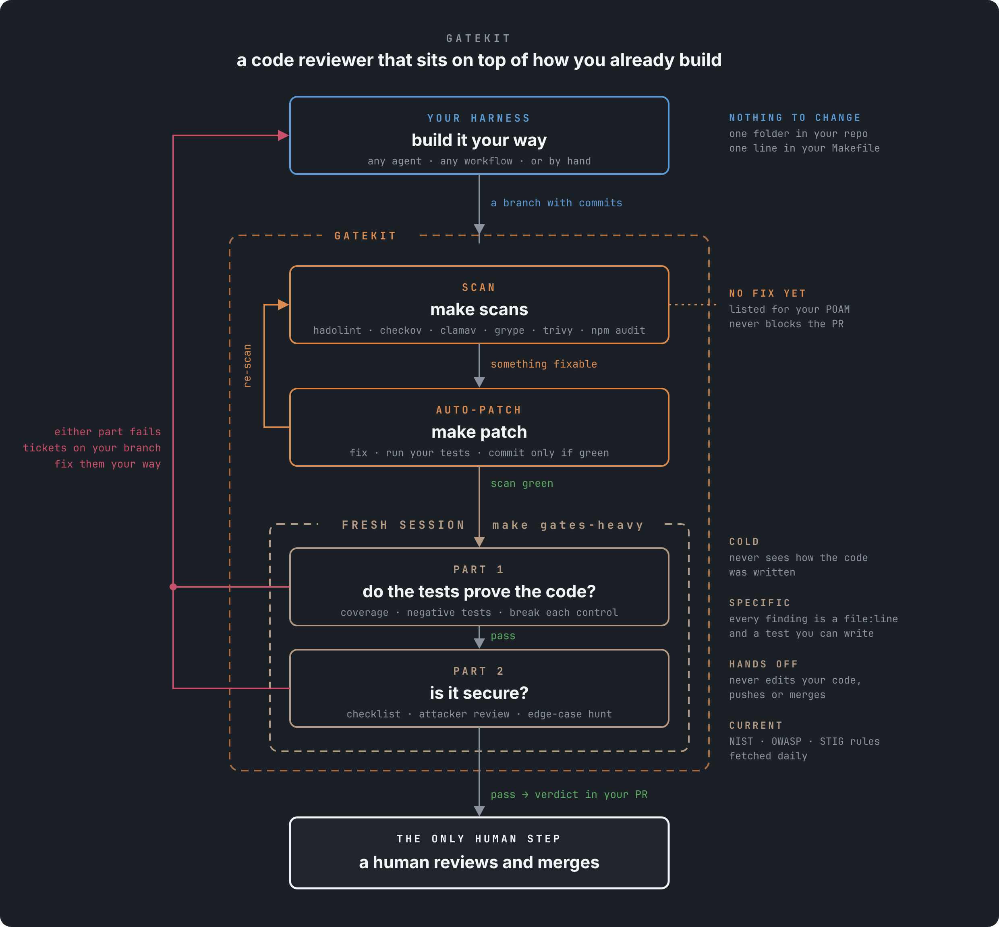

# gatekit



Over the past two years I've been building applications for IL4 and IL6 environments. Multiple
packages have reached ATO and several more are in process.

I started out using the BMAD Method for building and reviewing code, and later picked up Matt
Pocock's skills and Addy Osmani's agent skills. Their influence runs through the harnesses I build
with.

Gatekit is the code-review side of that work: a fleshed-out method for scanning and reviewing code
headed for IL4 and IL6 environments. It is built from what platform teams look for, what the
industry treats as standard, and what the governing rule sets require (NIST 800-53, OWASP Top 10,
DISA STIGs). It also tests your tests, with mutation testing among the checks.

At first, inference was used for every part of the review. Over time, each check that could be
made mechanical was moved into a script.

It sits on top of whatever harness you build with. It's one more tool for code review, most useful
when you're building for those environments.

---

Security scans and an AI code review for every pull request, in one folder you drop into your repo.

- **Scans** your code and containers for known security problems.
- **Fixes** the ones that have a fix, runs your tests, and commits only if they pass.
- **Lists** the ones with no fix yet for your POAM.
- **Reviews** your pull request with Claude before a human looks at it.

Problems the review finds become tickets on your branch. You fix them on the same branch, so the
fixes land in the same PR. If you use a ticket tracker, gatekit can copy the tickets there too.

It's for full-stack web apps (Node/TypeScript backend and frontend, Docker images). It's a helper
tool: nothing forces you to run it.

---

## Install

From your repo's root folder:

```bash
curl -fsSL https://raw.githubusercontent.com/secure-builder-dev/gatekit/main/install.sh | bash
```

This copies the `.gatekit/` folder into your repo, adds one line to your `Makefile`, and starts setup.

Setup (`make gatekit-init`) does four things:
- works out where your apps are and how to run your tests
- asks which of your Claude Code connections is your ticket tracker, if you have one (optional)
- asks whether you want a **controls manifest** (see below)
- installs the gate reviewer and `/implement` into `.claude/`

Then commit:

```bash
git add .gatekit .claude .gitignore Makefile && git commit -m "add gatekit"
```

**You need:** git, Docker (or Podman), Node/npm, jq, python3, curl, and [Claude Code](https://claude.com/claude-code)
for the review. The `gh` (GitHub) or `glab` (GitLab) command lets the review add its verdict to your PR.

---

## The commands

| Command | What it does |
|---|---|
| `make gatekit-init` | First-time setup. |
| `make scans` | Runs every scanner. Says PASS, or tells you how many problems are fixable and how many are not. |
| `make patch` | Fixes everything fixable, runs your tests, re-scans. Commits only if tests pass. |
| `make gates-light` | Quick review: does the code work and do the tests prove it, plus the basic security checklist. |
| `make gates-heavy` | Full review: light, plus an attacker-style review and an edge-case hunt. |

**These happen automatically:**
- `make scans` runs `make patch` itself when it finds something fixable.
- The review copies its tickets to your ticket tracker, if you set one.
- The review puts its verdict in your PR description.
- Gatekit updates itself.

### Ticket tracker (optional)

Tickets are files on your branch, and that's all gatekit needs. If you'd also like them in your
tracker (Windshift, Jira, Linear, GitHub Issues, or anything else with a Claude Code connection),
set its connection name in `.gatekit/config.yaml`:

```
TRACKER_MCP: <a name from: claude mcp list>
```

The review then creates one item per ticket and keeps its status up to date. Leave it empty and
nothing is sent anywhere.

---

## On every pull request

```
1. make scans                      → scans, auto-patches, re-scans
2. make gates-light  (or -heavy)   → Claude reviews; tickets go to your branch
3. fix the tickets                 → /implement T-001 in Claude Code, or fix it yourself
4. make gates-light  (or -heavy)   → again, until PASS; the verdict lands in your PR
```

### Light or heavy?

Pick **heavy** when your PR touches any of these:
- login, sessions, tokens, passwords
- roles, permissions, admin
- file uploads
- database migrations
- encryption

Pick **light** for everything else. **Not sure? Pick heavy.**

---

## Words you'll see

| Word | Meaning |
|---|---|
| **CVE** | A known security bug in a package, with an ID like `CVE-2026-1234`. |
| **Patchable** | A newer version of the package fixes it. |
| **POAM** | The official list of security problems you can't fix yet, with the reason. See [.gatekit/POAM-GUIDE.md](.gatekit/POAM-GUIDE.md). |
| **Gate** | The Claude review. It runs in a fresh session that knows nothing about how the code was written, and says PASS or FAIL. |
| **Ticket** | A small file describing one problem and what "fixed" looks like (`done_when`). |
| **Controls manifest** | Optional list of your app's security checks (`.gatekit/CONTROLS.md`). With it, `make gates-heavy` breaks each check on purpose to prove your tests notice. |

---

## Where things go

```
.gatekit/
  config.yaml              your settings (written by make gatekit-init)
  CONTROLS.md              your controls manifest (optional)
  records/<your-branch>/
    tickets/T-001.md       problems found, one per file
    gate-log.md            one line per review
    verdict.md             the latest verdict (also in your PR)
    poam-candidates.md     problems with no fix yet
```

Everything in `records/` is committed on your branch, so reviewers see it in the PR.

---

## Staying up to date

- **Gatekit** checks for a new release before each command and updates itself, then commits
  `gatekit: update to vX.Y.Z`. If it can't reach GitHub for 14 days, it stops until it can.
- **Scanners** are bumped weekly in this repo, tested, and released.
- **CVE lists** download fresh on every scan.
- **Security rules** (NIST 800-53, OWASP Top 10, DISA STIGs) are fetched before a review, at most
  once a day. Each gate-log line records which edition it used, so you can always see why
  something passed.

---

## Security

Found a vulnerability? Please report it privately. See [SECURITY.md](SECURITY.md).

## Licence

Copyright 2026 Casey Houle. Licensed under [Apache-2.0](LICENSE).
